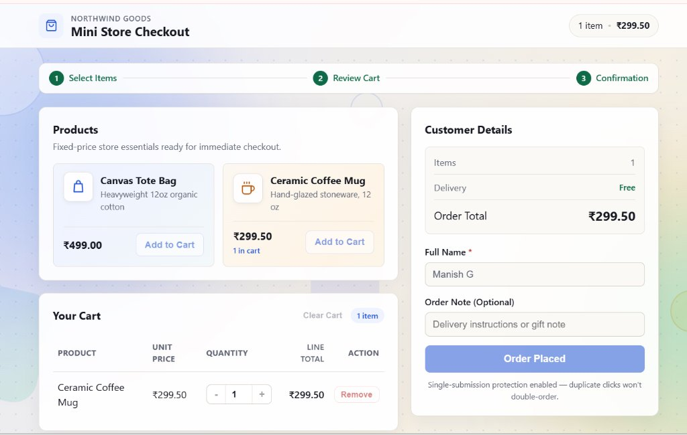

# Mini Store Checkout & Browser Test Suite

A single-page **Mini Store Checkout** web application built with zero-dependency Node.js + vanilla HTML/CSS/JS, paired with an automated **Playwright** browser test suite, prioritized risk-based test plan, and documented test results.

## Preview



---

## Key Features

- **Fixed-Price Product Catalog (INR `₹`):**
  - **Canvas Tote Bag** — `₹499.00` (`49900` paise)
  - **Ceramic Coffee Mug** — `₹299.50` (`29950` paise)
  - All line totals and order totals are calculated in integer paise and formatted with `Intl.NumberFormat('en-IN')` to prevent floating-point drift.
- **Interactive Cart Management:** Add items, increment/decrement with `-` / `+` buttons, edit quantities directly (`1`–`99`), remove individual items, or clear the cart in one click.
- **Validation & Input Preservation:** Blocks checkout when the cart is empty or `Full Name` is blank/whitespace-only, displays a clear accessible `role="alert"` message, marks invalid fields (`aria-invalid="true"`), and preserves all entered cart items, quantities, and notes.
- **Duplicate-Order Protection (Idempotency):** Synchronous `orderPlaced` guard plus immediate button disable (`Place Order` → `Order Placed`) guarantees rapid double-clicks produce only **one** `Order Confirmed` receipt and **one** unique order reference (`ORD-...`).
- **Polished UI/UX & Motion:**
  - Sticky top header with live item count & total pill, 3-step checkout progress indicator, and responsive two-column layout.
  - Animated multi-tone background with moving dot grid, sweeping color orbs, floating geometric shapes, card hover sheens, confirmation confetti burst, `Copy` reference button, and full `prefers-reduced-motion: reduce` support.

---

## Project Structure

```text
mini-checkout/
├── assets/
│   └── checkout-preview.jpg # UI preview screenshot
├── public/
│   ├── index.html          # Single-page checkout markup
│   ├── styles.css          # Layout, frosted cards, and animations
│   └── app.js              # Cart state, INR paise math, validation, idempotent submit
├── tests/
│   └── checkout.spec.js    # 3 clean-state Playwright browser checks
├── server.js               # Zero-dependency Node.js static server (127.0.0.1:4173)
├── playwright.config.js    # Playwright config (auto-starts server.js)
├── package.json            # Scripts: start, test, test:headed
├── TEST_PLAN.md            # Prioritized checkout risks (P0–P3) & test cases
└── TEST_RESULTS.md         # Automated/manual test evidence & defect log
```

---

## Prerequisites

- [Node.js](https://nodejs.org/) (v18 or newer)

---

## Setup & Run Locally

1. **Install dependencies:**

   ```bash
   npm install
   ```

2. **Install Playwright's Chromium browser** (one-time setup if not already cached):

   ```bash
   npx playwright install chromium
   ```

3. **Start the application:**

   ```bash
   npm start
   ```

   Open **`http://127.0.0.1:4173`** in your browser.

---

## Running Automated Browser Tests

Each Playwright check in [`tests/checkout.spec.js`](./tests/checkout.spec.js) starts from a clean page load (`/`), uses user-facing assertions (`toBeVisible`, `toHaveText`, `toHaveValue`, `toHaveCount`, `toBeDisabled`), and avoids fixed waits.

- **Headless run** (Playwright automatically starts and stops `node server.js`):

  ```bash
  npm test
  ```

- **Headed run** (watch tests execute in a visible browser window):

  ```bash
  npm run test:headed
  ```

### Automated Checks Covered

| # | Check | What It Verifies |
| --- | --- | --- |
| 1 | **Successful Checkout** | Adds items (`₹798.50`), fills `Full Name` & `Order Note`, submits, asserts 1 confirmation with `ORD-...` reference, and verifies a follow-up click on the disabled button cannot create a duplicate order. |
| 2 | **Missing Required Field** | Submits with whitespace-only `Full Name`, asserts `role="alert"` validation and `aria-invalid="true"`, verifies 0 confirmations, and confirms cart items & entered inputs remain preserved. |
| 3 | **Quantity & Removal Math** | Verifies exact line totals and order total updates across `+` increments, direct numeric input, `-` decrements, and item removal (`₹798.50` → `₹1,796.50` → `₹2,096.00` → `₹1,597.00` → `₹599.00`). |

---

## Manual Browser Testing Steps

1. Start the server (`npm start`) and open `http://127.0.0.1:4173`.
2. **Empty Cart Check (`TC-MAN-01`):**
   - Click **Place Order** with an empty cart and blank `Full Name` → verify submission is blocked with an alert.
   - Enter a `Full Name` and `Order Note` while the cart is still empty, then click **Place Order** → verify submission remains blocked and both fields stay preserved.
   - Add an item, click **Remove** back to `₹0.00`, and click **Place Order** → verify checkout is still blocked.
3. **Rapid Double-Click Check (`TC-MAN-02`):**
   - Add products, fill `Full Name`, and rapidly double-click **Place Order**.
   - Verify only **one** `Order Confirmed` receipt and **one** order reference appear, and the button switches to disabled **Order Placed**.

---

## Test Documentation & Defect Log

- **[TEST_PLAN.md](./TEST_PLAN.md)** — Risk-prioritized test strategy (`P0`–`P3`) and detailed automated/manual test cases.
- **[TEST_RESULTS.md](./TEST_RESULTS.md)** — Recorded automated and exploratory test outcomes, including **`DEF-001`** (a real blur-induced DOM re-render bug caught by Playwright Check 3 where editing a quantity input swallowed the next button click, resolved by updating row totals in place).
